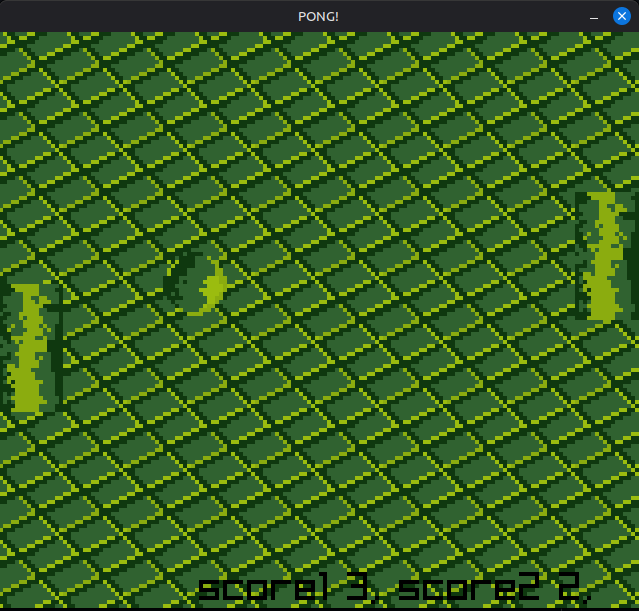

Dummy pong implementation with self made sprites.


# Screenshot



# Sprite Sheet


# Build & Run
```
make clean
make main
make run # or ./main
```

# External Libraries

- [https://github.com/raysan5/raylib](Raylib)
- [FastNoiseLite](https://github.com/Auburn/FastNoiseLite/tree/master/C)